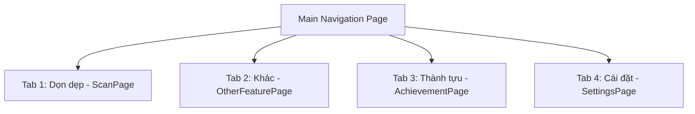

# Hướng dẫn Hệ thống Màn hình và Tính năng Twinfix

Tài liệu này cung cấp danh sách đầy đủ các màn hình trong ứng dụng **Twinfix**, kèm theo các tính năng chi tiết của từng màn hình, được ánh xạ chính xác với mã nguồn Flutter và các thuật ngữ bản địa hóa tiếng Việt của dự án.

---

## 1. Màn hình Khởi động & Hướng dẫn (Splash & Onboarding)

### 1.1. Màn hình Chào mừng (`SplashPage` - `/`)
- **Vai trò**: Điểm khởi đầu của ứng dụng, tải các cấu hình hệ thống ban đầu.
- **Tính năng chính**:
  - Kiểm tra trạng thái đăng nhập của người dùng (`AppCubit`).
  - Kiểm tra trạng thái gói cước Premium của người dùng (`SubscriptionCubit`).
  - Tự động điều hướng thông minh dựa trên lịch sử hoạt động:
    - Nếu là lần đầu tiên cài đặt: Điều hướng tới **Onboarding**.
    - Nếu chưa xem Paywall giới thiệu: Điều hướng tới **Paywall** (bỏ qua nếu là tài khoản Premium).
    - Các trường hợp còn lại: Điều hướng thẳng tới màn hình chính **Scan**.

### 1.2. Màn hình Hướng dẫn Người dùng Mới (`OnboardingPage` - `/onboarding`)
- **Vai trò**: Giới thiệu giao diện và các tính năng cốt lõi của Twinfix cho người dùng mới.
- **Tính năng chính**:
  - Trình chiếu slide giới thiệu trực quan về ứng dụng.
  - Hướng dẫn mô phỏng tương tác dọn dẹp bằng cử chỉ vuốt (Swipe Demo):
    - **Vuốt sang trái**: Chuẩn bị Xóa hình ảnh.
    - **Vuốt sang phải**: Giữ lại hình ảnh.
  - Nút **"Bỏ qua" (Skip)** hoặc **"Bắt đầu dọn dẹp" (Get Started)** để đi tiếp.

---

## 2. Các màn hình chính (Main Tabs Navigation)

Màn hình chính `MainPage` chứa thanh điều hướng phía dưới (Bottom Navigation Bar) cho phép di chuyển mượt mà giữa 4 tab cốt lõi:

### 2.1. Tab 1: Dọn dẹp (`ScanPage` - `/scan`)
- **Vai trò**: Giao diện trung tâm để thực hiện chức năng quét dọn rác bộ nhớ nhanh chóng.
- **Tính năng chính**:
  - **Hướng dẫn tương tác trực quan (Tutorial Overlay)**: Khi sử dụng lần đầu, hệ thống sẽ hiển thị một lớp phủ hướng dẫn chỉ dẫn chi tiết hai tính năng chính là quét nhanh và quản lý thư viện.
  - **Bắt đầu dọn dẹp (Start Scan)**: Nút kích hoạt quét nhanh. Hệ thống sẽ yêu cầu quyền truy cập Thư viện ảnh (Photo Permission), sau đó quét để tìm ảnh trùng lặp, mờ, màn hình... và chuyển sang màn hình kết quả.
  - **Quản lý ảnh (Gallery Manager)**: Nút truy cập nhanh vào trình quản lý thư viện thủ công.

### 2.2. Tab 2: Tính năng khác (`OtherFeaturePage` - `/other_feature`)
- **Vai trò**: Nơi tập hợp toàn bộ các công cụ biên tập, tối ưu hóa ảnh bằng AI và các tiện ích bảo mật thông tin.
- **Tính năng chính**:
  - **Dọn dẹp Live Photos (iOS Only)**: Lọc và hiển thị riêng các ảnh động Live Photos trên iOS để người dùng dọn dẹp giải phóng dung lượng lớn.
  - **Danh sách công cụ xử lý chuyên biệt**:
    - **Xóa GPS**: Loại bỏ dữ liệu tọa độ địa lý khỏi ảnh để bảo vệ quyền riêng tư.
    - **Thêm Watermark**: Chèn dấu chìm bản quyền vào ảnh.
    - **Ẩn khuôn mặt**: Làm mờ khuôn mặt bằng thuật toán AI phát hiện tự động.
    - **Phát hiện tài liệu**: Tìm và gom nhóm ảnh chứa văn bản, hóa đơn, giấy tờ.
    - **Chỉnh sửa ảnh**: Trình biên tập cắt, vẽ, lọc màu chuyên sâu.
    - **Phát hiện ảnh mờ**: Quét và lọc ra các ảnh bị nhòe để giải phóng dung lượng.

### 2.3. Tab 3: Thành tựu (`AchievementPage` - `/achievement`)
- **Vai trò**: Bảng điều khiển (Dashboard) theo dõi tiến trình dọn dẹp cá nhân hóa của người dùng.
- **Tính năng chính**:
  - **Cảnh báo dung lượng (Memory Warning)**: Hiển thị thanh cảnh báo khẩn cấp màu đỏ nổi bật khi dung lượng bộ nhớ thiết bị đã đầy từ 85% trở lên.
  - **Cấp độ dọn dẹp (User Level & Progress)**: Thẻ hiển thị Level hiện tại và thanh kinh nghiệm (XP) tăng dần mỗi khi người dùng xóa ảnh thành công.
  - **Thống kê hoạt động (Stats Card)**:
    - **Chuỗi ngày (Streak)**: Đếm số ngày dọn dẹp liên tục với biểu tượng ngọn lửa.
    - **Ảnh đã xóa (Items Deleted)**: Tổng số tệp đã xóa thành công.
  - **Bộ sưu tập Huy hiệu (Earned Badges)**: Hiển thị danh sách các huy hiệu danh giá đã mở khóa. Người dùng có thể nhấn "Xem tất cả huy hiệu" để mở **Badge Gallery**.
  - **Biểu đồ hoạt động dọn dẹp (Activity Heatmap)**: Biểu đồ đóng góp 365 ngày (phong cách GitHub đóng góp) ghi nhận tần suất và mức độ dọn dẹp mỗi ngày.

### 2.4. Tab 4: Cài đặt (`SettingsPage` - `/settings`)
- **Vai trò**: Cấu hình và cá nhân hóa trải nghiệm sử dụng Twinfix.
- **Tính năng chính**:
  - **Hồ sơ cá nhân (Account Section)**:
    - Nếu chưa đăng nhập: Hiển thị ảnh đại diện mặc định và nút **"ĐĂNG NHẬP"** để kích hoạt sao lưu tiến trình.
    - Nếu đã đăng nhập: Hiển thị tên, email và Avatar kèm Khung viền tùy chỉnh đẳng cấp. Cho phép truy cập cài đặt hồ sơ sâu hoặc Đăng xuất.
  - **Gói Premium**: Thể hiện trạng thái gói hiện tại (Free / Premium) và nút nâng cấp lên Premium.
  - **Ngôn ngữ (Language)**: Hỗ trợ chuyển đổi nhanh tức thì giữa **Tiếng Anh** và **Tiếng Việt**.
  - **Giới hạn quét (Scan Limit)**: Cấu hình giới hạn số lượng ảnh tối đa quét mỗi lần (Ví dụ: 100, 200, 500 ảnh hoặc quét Tất cả). Có cảnh báo tốn pin/thời gian nếu chọn Tất cả.
  - **Diện mạo (Appearance - Chỉ dành cho Premium)**:
    - Thay đổi Theme của ứng dụng (Sáng, Tối, hoặc đi theo Hệ thống).
    - Tùy chỉnh phong cách hình nền (Wallpaper) của ứng dụng bằng các hình nền nghệ thuật tích hợp sẵn hoặc tự tải ảnh từ thư viện của mình lên.
  - **Đồng bộ dữ liệu (Sync Button - góc phải thanh tiêu đề)**: Cho phép chủ động đồng bộ dữ liệu cục bộ với đám mây, hỗ trợ hộp thoại lựa chọn **kết hợp dữ liệu cũ (Merge Data)** hoặc **bắt đầu mới (Start Fresh)**.
  - **Về chúng tôi (About Us)**: Liên kết đến thông tin phiên bản, điều khoản dịch vụ và chính sách bảo mật.

---

## 3. Các màn hình chức năng chuyên sâu (Detail & Utilities Screens)

### 3.1. Phân hệ Quét ảnh Trùng lặp
- **Màn hình Đang quét (`ScanLoadingPage` - `/scan_loading`)**:
  - Hiển thị hiệu ứng chờ quét trực quan kèm mascot linh vật dễ thương đang quét thiết bị.
- **Màn hình Kết quả quét (`ScanResultPage` - `/scan_result`)**:
  - Gom các ảnh trùng lặp hoặc cực kỳ giống nhau thành từng nhóm rõ ràng.
  - Cho biết chính xác dung lượng tiết kiệm được nếu xóa.
  - Người dùng có thể nhấn giữ để kích hoạt chế độ chọn nhanh, hoặc xem chi tiết từng ảnh để so sánh.
- **Màn hình Xác nhận xóa (`ConfirmDeletePage` - `/confirm_delete`)**:
  - Một lớp màn hình cảnh báo cực kỳ quan trọng hiển thị tổng dung lượng và số lượng ảnh chuẩn bị xóa vĩnh viễn, ngăn ngừa rủi ro bấm nhầm.

### 3.2. Trình quản lý Thư viện & Xem chi tiết
- **Màn hình Chọn loại phương tiện (`MediaTypeSelectionPage` - `/media_type_selection`)**:
  - Lựa chọn nhanh giữa dọn dẹp **Ảnh (Photo)** hoặc **Video**.
- **Màn hình Quản lý ảnh (`GalleryManagerPage` - `/gallery_manager`)**:
  - Hiển thị danh sách ảnh/video dưới dạng lưới (Grid), có thể lọc theo danh mục cụ thể (Ảnh mờ, Ảnh màn hình, Live Photos...).
  - **Bộ lọc Sắp xếp (Sort)**: Hỗ trợ sắp xếp theo Ngày giảm/tăng dần, Kích thước giảm/tăng dần để dễ dàng phát hiện ảnh dung lượng lớn nhất.
  - **Xóa hàng loạt (Bulk Delete)**: Cho phép chọn nhanh tất cả (Select All) để xóa hàng loạt chỉ trong một lần chạm.
- **Màn hình Xem ảnh & Vuốt dọn dẹp (`MediaViewerPage` - `/media_viewer`)**:
  - Xem ảnh/video toàn màn hình với chất lượng gốc.
  - **Trải nghiệm cử chỉ vuốt độc đáo**:
    - **Vuốt Lên hoặc Sang Trái**: Thêm ảnh vào danh sách chờ **Xóa**.
    - **Vuốt Xuống hoặc Sang Phải**: Giữ lại ảnh (**Giữ**).
    - Tạo cảm giác dọn dẹp nhanh chóng như lướt các ứng dụng hẹn hò.

### 3.3. Bộ công cụ Tiện ích (Other Features)
- **Màn hình Xóa thông tin GPS (`RemoveGPSPage` - `/remove_gps`)**:
  - Quét tìm tất cả các ảnh có chứa tọa độ bản đồ trong siêu dữ liệu EXIF.
  - Cho phép loại bỏ thông tin vị trí nhạy cảm này chỉ bằng một nút bấm để an tâm chia sẻ lên mạng xã hội.
- **Màn hình Thêm Dấu chìm (`WatermarkPage` - `/watermark`)**:
  - Chèn chữ ký, logo bảo quyền vào hình ảnh.
  - Tích hợp 5 mẫu template dấu chìm cực đẹp: Tiêu chuẩn, Viền, Trong suốt, Bản quyền, Tối giản.
  - Tùy chỉnh thanh trượt linh hoạt: Độ đậm nhạt (Opacity), Kích thước chữ (Size), Mật độ dấu chìm phủ khắp ảnh (Density).
  - Cho phép chọn "Ghi đè bản gốc" hoặc "Tạo bản sao mới".
- **Màn hình Làm mờ khuôn mặt AI (`FaceBlurPage` - `/face_blur`)**:
  - Tự động nhận dạng toàn bộ khuôn mặt có trong ảnh bằng AI.
  - Cung cấp các chế độ che mặt bảo mật cực kỳ phong phú:
    - **Làm mờ (Blur)**
    - **Dạng điểm ảnh (Pixelate)**
    - **Màu đặc (Solid)**
    - **Emoji hài hước**: Kính râm, Mặt nạ phòng độc, Thanh đen che mắt (Eye Bar) hoặc chọn bất kỳ Emoji nào trên hệ điều hành.
  - Tùy chỉnh độ đậm nhạt và kích thước của vùng che.
- **Màn hình Phát hiện tài liệu (`DocumentDetectionPage` - `/document_detection`)**:
  - Tự động phân tích và gom tất cả ảnh có chứa ký tự văn bản, giấy tờ, hóa đơn, bằng cấp vào một nơi để người dùng quản lý riêng hoặc dọn dẹp hàng loạt các hóa đơn cũ hết hạn.
- **Màn hình Chỉnh sửa ảnh (`ImageEditorPage` - `/image_editor`)**:
  - Trình biên tập hình ảnh đa năng: Vẽ tự do (Paint), Thêm văn bản (Text), Cắt xén và xoay ảnh (Crop), Bộ lọc màu nghệ thuật (Filter), và tinh chỉnh ánh sáng (Tune).
- **Màn hình Phát hiện ảnh mờ (`BlurDetectionPage` - `/blur_detection`)**:
  - Dùng thuật toán phân tích tần số ảnh để phát hiện và liệt kê các ảnh chụp bị nhòe, out nét, rung tay để người dùng dễ dàng xóa chúng đi.

### 3.4. Hệ thống Huy hiệu & Lịch sử
- **Màn hình Chi tiết Huy hiệu (`BadgeDetailPage` - `/badge_detail`)**:
  - Xem mô tả của huy hiệu, trạng thái đã đạt được hay chưa và nhiệm vụ cần thực hiện để mở khóa nó.
- **Màn hình Thư viện Huy hiệu (`BadgeGalleryPage` - `/badge_gallery`)**:
  - Danh sách tất cả các huy hiệu có trong game hóa (Gamification) của Twinfix như Người mới dọn dẹp, Sát thủ ảnh mờ, Máy nghiền ảnh... giúp tăng động lực dọn dẹp hàng ngày.
- **Màn hình Chi tiết Hoạt động (`ActivityDetailPage` - `/activity_detail`)**:
  - Hiển thị nhật ký dọn dẹp lịch sử chi tiết theo dòng thời gian, ghi rõ ngày nào đã xóa bao nhiêu ảnh và giải phóng được bao nhiêu MB/GB dung lượng.

### 3.5. Tài khoản, Bảo mật & Paywall
- **Màn hình Đăng nhập (`LoginPage` - `/login`)**:
  - Đăng nhập bằng Email/Mật khẩu hoặc Đăng nhập nhanh một chạm bằng Google.
  - Hộp thoại hỏi kết hợp dữ liệu (Merge Data) khi đăng nhập thành công từ trạng thái khách.
- **Màn hình Đăng ký (`RegisterPage` - `/register`)**:
  - Tạo tài khoản mới. Ràng buộc bảo mật mật khẩu cao (tối thiểu 8 ký tự, có đủ chữ hoa, chữ thường, số, ký tự đặc biệt).
- **Màn hình Quên mật khẩu (`ForgotPasswordPage` - `/forgot_password`)**:
  - Điền email để nhận liên kết khôi phục mật khẩu.
- **Màn hình Đổi mật khẩu (`ChangePasswordPage` - `/change_password`)**:
  - Dành cho tài khoản email thường để cập nhật mật khẩu mới định kỳ.
- **Màn hình Thiết lập hồ sơ (`ProfileSettingsPage` - `/profile_settings`)**:
  - Chỉnh sửa thông tin Họ tên.
  - **Chọn ảnh đại diện (Select Avatar)** từ bộ sưu tập mascot cực ngầu.
  - **Đổi khung viền (Change Frame)**: Thêm các khung viền rực rỡ quanh avatar đại diện.
- **Màn hình Mua Premium (`PaywallPage` - `/paywall`)**:
  - Trang thương mại của Twinfix giới thiệu 3 tính năng Premium độc quyền: Không quảng cáo, Mở khóa toàn bộ công cụ AI, và Biên tập ảnh chất lượng cao.
  - Hỗ trợ các gói cước linh hoạt: Miễn phí, Đăng ký Tháng, Trọn đời.
  - Tính năng khôi phục mua hàng (Restore Purchases).
- **Màn hình Về chúng tôi (`AboutPage` - `/about_us`)**:
  - Hiển thị logo, phiên bản hiện tại của ứng dụng.
  - Nút truy cập Trang web hỗ trợ, Chính sách bảo mật và Điều khoản sử dụng.
