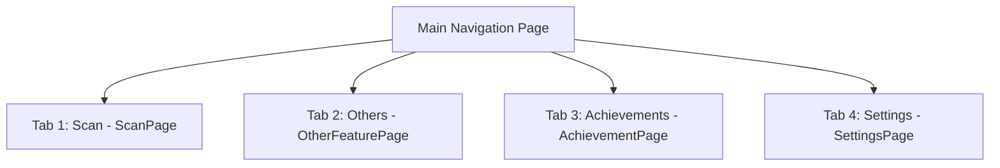

# Twinfix Screen & Feature Guide

This document provides a comprehensive list of screens in the **Twinfix** application, along with detailed features for each screen, accurately mapped to the Flutter source code.

---

## 1. Splash & Onboarding

### 1.1. Splash Screen (`SplashPage` - `/`)
- **Role**: The starting point of the application, loading initial system configurations.
- **Key Features**:
  - Checks user authentication state (`AppCubit`).
  - Checks user's Premium subscription status (`SubscriptionCubit`).
  - Smart auto-navigation based on activity history:
    - First-time installation: Navigates to **Onboarding**.
    - Has not seen the Paywall: Navigates to **Paywall** (skipped for Premium users).
    - Other cases: Navigates directly to the main **Scan** screen.

### 1.2. Onboarding Screen (`OnboardingPage` - `/onboarding`)
- **Role**: Introduces the interface and core features of Twinfix to new users.
- **Key Features**:
  - Visual presentation of app features.
  - Interactive swipe cleanup simulation (Swipe Demo):
    - **Swipe Left**: Mark image for deletion.
    - **Swipe Right**: Keep image.
  - **"Skip"** or **"Get Started"** buttons to proceed.

---

## 2. Main Tabs Navigation

The `MainPage` contains a Bottom Navigation Bar that allows smooth transitions between 4 core tabs:

### 2.1. Tab 1: Scan (`ScanPage` - `/scan`)
- **Role**: The central interface for quickly performing storage cleanup scans.
- **Key Features**:
  - **Tutorial Overlay**: On first use, displays a tutorial highlighting the quick scan and gallery management features.
  - **Start Scan**: Triggers a quick scan. Requests Photo Permissions, then scans for duplicate, blurry, or screenshot images, moving to the results screen.
  - **Gallery Manager**: Quick access to the manual gallery manager.

### 2.2. Tab 2: Other Features (`OtherFeaturePage` - `/other_feature`)
- **Role**: A collection of AI-powered editing tools, optimization utilities, and privacy features.
- **Key Features**:
  - **Clean up Live Photos (iOS Only)**: Filters and displays Live Photos on iOS to free up significant space.
  - **Specialized Tools List**:
    - **Remove GPS**: Strips geographic coordinates from photos to protect privacy.
    - **Add Watermark**: Inserts a copyright watermark into images.
    - **Hide Faces**: Blurs faces using automatic AI detection.
    - **Document Detection**: Finds and groups photos containing text, receipts, or documents.
    - **Image Editor**: Advanced editor for cropping, drawing, and applying color filters.
    - **Blur Detection**: Scans and filters out blurry photos to free up space.

### 2.3. Tab 3: Achievements (`AchievementPage` - `/achievement`)
- **Role**: A personalized dashboard to track the user's cleanup progress.
- **Key Features**:
  - **Memory Warning**: Displays an urgent red warning bar when device storage is 85% full or more.
  - **User Level & Progress**: Card showing the current Level and Experience (XP) bar that increases upon successful deletions.
  - **Stats Card**:
    - **Streak**: Counts consecutive days of cleaning (flame icon).
    - **Items Deleted**: Total number of successfully deleted files.
  - **Earned Badges**: Displays a list of unlocked badges. Users can tap "View all badges" to open the **Badge Gallery**.
  - **Activity Heatmap**: A 365-day contribution chart (GitHub style) recording the frequency and volume of cleanups per day.

### 2.4. Tab 4: Settings (`SettingsPage` - `/settings`)
- **Role**: Configuration and personalization of the Twinfix experience.
- **Key Features**:
  - **Account Section**:
    - If not logged in: Shows a default avatar and a **"LOGIN"** button to enable progress backup.
    - If logged in: Displays Name, Email, and Avatar with a custom premium frame. Allows access to deep profile settings or Logout.
  - **Premium Plan**: Shows current plan status (Free / Premium) and a button to upgrade.
  - **Language**: Instant toggle between **English** and **Vietnamese**.
  - **Scan Limit**: Configures the maximum number of images scanned at once (e.g., 100, 200, 500, or All). Includes a battery/time warning if "All" is selected.
  - **Appearance (Premium Only)**:
    - Change app Theme (Light, Dark, or System).
    - Customize app wallpaper using built-in art or by uploading from the library.
  - **Sync Button (top right)**: Manually sync local data with the cloud, with a dialog to choose between **Merge Data** or **Start Fresh**.
  - **About Us**: Links to app version, terms of service, and privacy policy.

---

## 3. Detail & Utilities Screens

### 3.1. Duplicate Scan Module
- **Scanning Screen (`ScanLoadingPage` - `/scan_loading`)**:
  - Displays a visual loading effect with a cute mascot scanning the device.
- **Scan Result Screen (`ScanResultPage` - `/scan_result`)**:
  - Groups duplicate or highly similar photos logically.
  - Shows exact storage space saved if deleted.
  - Users can long-press for quick selection or tap for detailed comparison.
- **Confirm Delete Screen (`ConfirmDeletePage` - `/confirm_delete`)**:
  - A critical warning screen showing total size and count of items about to be permanently deleted to prevent accidental deletion.

### 3.2. Gallery Manager & Media Viewer
- **Media Type Selection Screen (`MediaTypeSelectionPage` - `/media_type_selection`)**:
  - Quick selection between cleaning **Photos** or **Videos**.
- **Gallery Manager Screen (`GalleryManagerPage` - `/gallery_manager`)**:
  - Displays a grid list of photos/videos, filterable by specific categories (Blurry, Screenshots, Live Photos, etc.).
  - **Sort Filters**: Sort by Date (Desc/Asc) or Size (Desc/Asc) to easily spot large files.
  - **Bulk Delete**: "Select All" option to delete multiple items with one tap.
- **Media Viewer & Swipe Screen (`MediaViewerPage` - `/media_viewer`)**:
  - View photos/videos in full screen at original quality.
  - **Unique Swipe Gestures**:
    - **Swipe Up or Left**: Add to the **Delete** queue.
    - **Swipe Down or Right**: **Keep** the item.
    - Creates a fast, dating-app style cleaning experience.

### 3.3. Utility Toolkit (Other Features)
- **Remove GPS Screen (`RemoveGPSPage` - `/remove_gps`)**:
  - Scans for photos containing map coordinates in EXIF metadata.
  - Removes sensitive location info with one tap for safe social media sharing.
- **Watermark Screen (`WatermarkPage` - `/watermark`)**:
  - Inserts signatures or copyright logos.
  - Integrates 5 beautiful templates: Standard, Border, Transparent, Copyright, Minimalist.
  - Flexible sliders: Opacity, Size, and Density.
  - Options to "Overwrite Original" or "Save as Copy".
- **AI Face Blur Screen (`FaceBlurPage` - `/face_blur`)**:
  - Automatically detects faces in photos using AI.
  - Rich privacy modes:
    - **Blur**
    - **Pixelate**
    - **Solid Color**
    - **Funny Emojis**: Sunglasses, Gas Mask, Eye Bar, or any OS emoji.
  - Customizable intensity and area size.
- **Document Detection Screen (`DocumentDetectionPage` - `/document_detection`)**:
  - Automatically analyzes and groups photos containing text, documents, or receipts for separate management or bulk deletion of expired bills.
- **Image Editor Screen (`ImageEditorPage` - `/image_editor`)**:
  - Versatile image editor: Free Paint, Add Text, Crop/Rotate, Artistic Filters, and Light Tuning.
- **Blur Detection Screen (`BlurDetectionPage` - `/blur_detection`)**:
  - Uses frequency analysis algorithms to detect and list blurry or out-of-focus photos for easy deletion.

### 3.4. Badges & History System
- **Badge Detail Screen (`BadgeDetailPage` - `/badge_detail`)**:
  - Shows badge descriptions, achievement status, and required tasks to unlock.
- **Badge Gallery Screen (`BadgeGalleryPage` - `/badge_gallery`)**:
  - List of all gamification badges (e.g., Cleaning Novice, Blur Assassin, Photo Crusher) to boost daily cleaning motivation.
- **Activity Detail Screen (`ActivityDetailPage` - `/activity_detail`)**:
  - Displays a detailed timeline of cleaning history, showing exactly how many photos were deleted and how much space (MB/GB) was freed on specific dates.

### 3.5. Account, Security & Paywall
- **Login Screen (`LoginPage` - `/login`)**:
  - Email/Password login or 1-tap Google Login.
  - "Merge Data" dialog shown when successfully logging in from a guest state.
- **Register Screen (`RegisterPage` - `/register`)**:
  - Create a new account with strict password security constraints (min 8 chars, uppercase, lowercase, numbers, special characters).
- **Forgot Password Screen (`ForgotPasswordPage` - `/forgot_password`)**:
  - Enter email to receive a password reset link.
- **Change Password Screen (`ChangePasswordPage` - `/change_password`)**:
  - For standard email accounts to periodically update passwords.
- **Profile Settings Screen (`ProfileSettingsPage` - `/profile_settings`)**:
  - Edit Full Name.
  - **Select Avatar** from a collection of cool mascots.
  - **Change Frame**: Add colorful borders around the avatar.
- **Paywall Screen (`PaywallPage` - `/paywall`)**:
  - Twinfix's commercial page introducing 3 exclusive Premium features: No Ads, Unlock all AI tools, and High-quality photo editing.
  - Flexible plans: Free, Monthly Subscription, Lifetime.
  - Restore Purchases functionality.
- **About Us Screen (`AboutPage` - `/about_us`)**:
  - Displays the logo and current app version.
  - Links to the Support Website, Privacy Policy, and Terms of Service.
